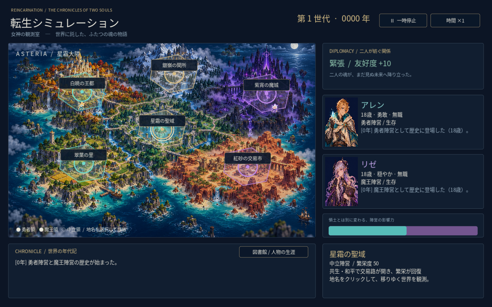

# 転生シミュレーション — 星霜大陸の年代記

女神の観測室から、勇者側のアレンと魔王側のリゼの人生を見守る2D放置ゲームです。



## 起動

Godot 4で `project.godot` を開き、F5で実行します。1440×900の画面をウィンドウへ拡縮します。描画はCompatibilityで、Godot 4.6.3で実描画・自動進行を検証しています。

- 2秒で1年進行。一時停止と×1 / ×2 / ×5の速度切り替え。
- 右側で現在の二人の年齢・性格・職業・所属・直近の出来事を確認。
- 出会いと性格が友好度を変え、戦争・緊張・和平・共生へ推移。
- 戦争で6地域の支配陣営と繁栄度が変わります。地図上の色付き領域と交戦印へ反映。
- 和平・共生では交易路を表示し、地域の繁栄度が回復。
- 地名をクリックすると地域詳細。「図書館 / 人物の生涯」で全人物の個人史を閲覧。
- 二人とも死亡すると次世代が転生。歴史と領土はプレイ中引き継ぎます。

## 素材

`assets/world_map.png` と `assets/portraits.png` は本作向けに生成したオリジナル素材です。`allen.svg` / `lize.svg` は地図用のオリジナルピクセルキャラクターです。HD-2D風の陰影・奥行きを持つ2D背景を使用し、3Dジオラマではありません。

日本語フォントはNoto Sans CJK JPのサブセットです。ライセンスは `assets/FONT-LICENSE.txt` を参照してください。

## 検証

```sh
godot --headless --editor --path . --import --quit
godot --headless --path . --script tests/simulation_test.gd
```

シナリオテストはUI操作、戦争による領土更新、和平による復興、共生、次世代継承、100年の進行と勢力比率を検証します。

現段階はプレイ可能なプロトタイプです。セーブ・ロード、終了中の時間進行、戦闘アニメーション、女神の介入は未実装です。終了すると進行はリセットされます。図書館は現在のプレイ中の記録を表示します。
